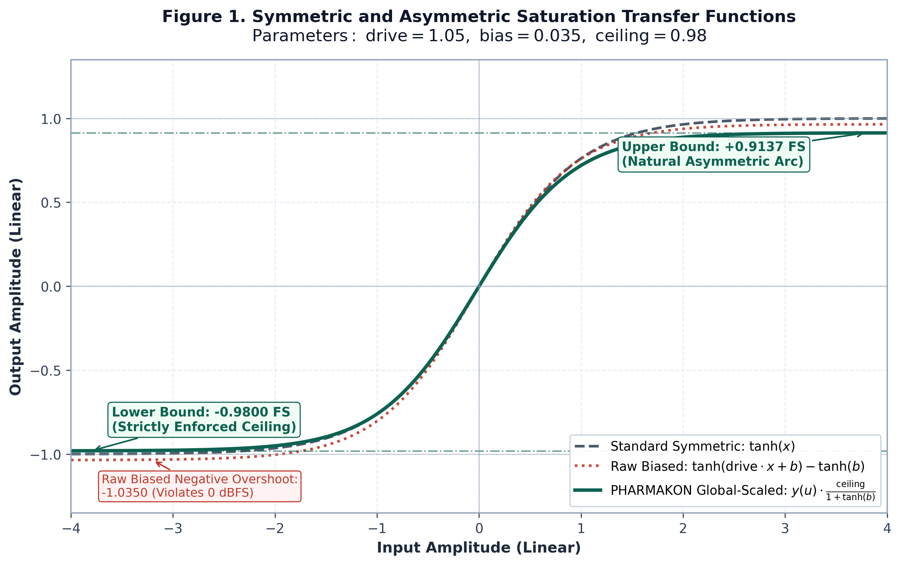
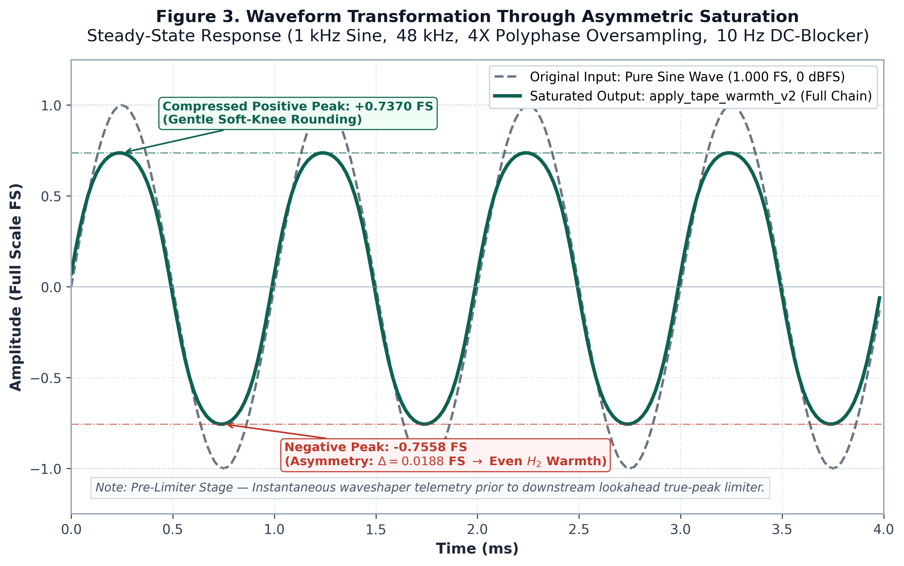
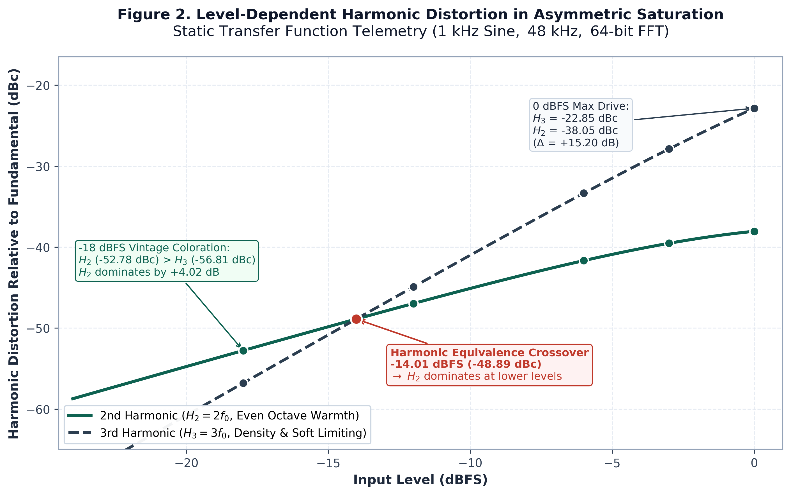

# Beyond tanh: Engineering Asymmetric Saturation for Digital Audio
## Harmonic Generation, Asymptote Scaling, and Polyphase Anti-Aliasing

**Author:** Lex Gerek (Sound Architect / Audio Engineer)  
**Project:** PHARMAKON 2.0 Studio Console  
**Document Status:** Technical Whitepaper — Final Production Edition (v2.6)  
**Implementation:** [`remaster_engine.py`](https://github.com/alex-gerek/PHARMAKON/blob/0af338f/remaster_engine.py#L130-L180) (`apply_tape_warmth_v2`)  
**Native Engine:** `pharmakon_dsp.hpp` (`TapeWarmthModule`)  
**PDF Edition:** [Download Camera-Ready PDF (`PHARMAKON_Saturation_Whitepaper.pdf`)](../PHARMAKON_Saturation_Whitepaper.pdf)  
**Theory Domain:** Non-Linear Waveshaping & Analog Magnetic Hysteresis (IEEE / AES)  
**License:** Permissive MIT License  

---

### Abstract

Digital soft-clipping circuits often rely on symmetric sigmoidal functions such as $\tanh(x)$ to tame excessive transient peaks. While computationally efficient, odd-symmetric saturation generates exclusively odd-order harmonics (3rd, 5th, 7th), failing to reproduce the rich, even-harmonic musicality characteristic of analog magnetic tape and transformer stages. Conversely, naive asymmetric biasing introduces parasitic DC offsets and unpredictable ceiling penetration.

This paper presents the mathematical derivation, numerical verification, and practical implementation of an analog-inspired asymmetric saturation processor. By combining high-frequency pre-emphasis, 4X polyphase oversampling, global asymptote scaling, and an integrated leaky DC-blocker, the system synthesizes a musical second harmonic at $-38.05\text{ dBc}$ while strictly enforcing a deterministic sample peak ceiling of $-0.18\text{ dBFS}$ ($0.9800$) at the waveshaper stage with zero DC drift in steady-state operation.

---

### 1. The Concrete Ceiling vs. The Analog Cushion

In fixed-point digital PCM systems, exceeding $0\text{ dBFS}$ results in abrupt hard clipping: the waveform tops are squared off flat. Mathematically, this discontinuity generates an extended series of harsh, unmusical odd harmonics that alias back across the audible spectrum as dissonant inharmonic sidebands.

In our own exploratory measurements of exported generative audio stems, we occasionally observed true-peak levels exceeding $0\text{ dBFS}$ due to lossy codec reconstruction artifacts; this is an empirical observation on our specific test files rather than a universal property of these generative platforms. Nonetheless, downstream playback systems and DAC reconstruction filters consistently penalize inter-sample peak overshoots with harsh analog-stage clipping.

Analog magnetic recording behaves fundamentally differently:
* As the signal level driving the record head increases, magnetic domains in the ferric oxide emulsion approach saturation gradually.
* The transfer curve transitions smoothly into compression, compressing peaks gently while generating progressive harmonic warmth.
* Crucially, physical non-linearities in magnetic tape, input transformers, and single-ended drive stages introduce subtle structural asymmetry between positive and negative half-waves.

To emulate this response in the digital domain without the massive CPU overhead of full partial-differential magnetic hysteresis modeling, we designed a specialized waveshaping processor centered around an offset hyperbolic tangent transfer function.

---

### 2. The Symmetry Barrier: Why Standard tanh Lacks Even Harmonics

A standard normalized soft-clipper is defined by:
$$f(x) = \tanh(x)$$

Because the hyperbolic tangent is an odd function:
$$\tanh(-x) = -\tanh(x)$$

When excited by a pure sinusoidal input $x(t) = A \sin(\omega t)$, the Taylor series expansion reveals:
$$\tanh(x) = x - \frac{x^3}{3} + \frac{2x^5}{15} - \frac{17x^7}{315} + \dots$$

Because only odd powers of $x$ exist in the polynomial expansion, even harmonics (2nd, 4th, 6th) are mathematically impossible under zero-bias conditions. The output contains strictly odd harmonics, sounding sterile or buzzy rather than warm.

---

### 3. Asymmetric Bias & The Exact Taylor Derivation

To induce a musically desirable second harmonic, we introduce an intentional static bias offset $b$ into the argument:
$$f(x) = \tanh(x \cdot \text{drive} + b) - \tanh(b)$$

Subtracting $\tanh(b)$ ensures that $f(0) = 0$, guaranteeing that digital silence passes through with zero static offset.

Evaluating the derivatives of $f(x)$ centered around $x = 0$ (for $\text{drive} = 1$):
* $f(0) = 0$
* $f'(0) = 1 - \tanh^2(b) = \text{sech}^2(b)$
* $f''(0) = -2 \tanh(b) \text{sech}^2(b)$
* $f'''(0) = -2 \text{sech}^2(b) [1 - 3\tanh^2(b)]$

The rigorous Taylor expansion around zero takes the form:
$$f(x) = \text{sech}^2(b) \cdot x - \left[\tanh(b)\text{sech}^2(b)\right] x^2 - \frac{1}{3}\text{sech}^2(b)\left[1 - 3\tanh^2(b)\right] x^3 + \mathcal{O}(x^4)$$

The appearance of the non-zero quadratic term $x^2$ is decisive. Substituting $x(t) = A \sin(\omega t)$:
$$x^2(t) = A^2 \sin^2(\omega t) = \frac{A^2}{2}[1 - \cos(2\omega t)]$$

The term $\cos(2\omega t)$ generates a pure second harmonic ($2 f_0$).

---

### 4. Resolving the Asymmetry Paradox: The Ceiling vs. H2 Dilemma

While the mathematical derivation above is sound, deploying raw biased $\tanh$ into a digital signal chain reveals two failure modes:

#### A. The Asymptote Imbalance
The expression $g(u) = \tanh(u + b) - \tanh(b)$ has unequal horizontal asymptotes:
* Upper asymptote ($u \to +\infty$): $1 - \tanh(b) = +0.9650$ (for $b = 0.035$)
* Lower asymptote ($u \to -\infty$): $-1 - \tanh(b) = -1.0350$

Multiplying by an uncorrected $\text{ceiling} = 0.98$ yields a negative peak of $-1.0350 \times 0.98 = -1.0143$, causing digital clipping on extreme negative peaks.

#### B. The Piecewise Normalization Trap
In an earlier revision (v2.1), an attempt was made to solve this via piecewise normalization, scaling positive inputs by $\frac{\text{ceiling}}{1 - \tanh(b)}$ and negative inputs by $\frac{\text{ceiling}}{1 + \tanh(b)}$.

Numerical re-verification revealed that this piecewise scaling destroys the very quadratic curvature it sought to preserve. By forcing both half-waves to balance at $\pm\text{ceiling}$, the effective transfer function became quasi-symmetric:
* **Raw Asymmetric Model:** $H_2 = -38.05\text{ dBc}$
* **Piecewise Scaled Model:** $H_2 = -67.74\text{ dBc}$ (a $29.7\text{ dB}$ collapse of the second harmonic!)

#### C. The Solution: Global Asymptote Scale Normalization
To preserve the exact quadratic transfer function and maintain $H_2$ at $-38.05\text{ dBc}$ while strictly preventing negative overshoot, we scale the entire waveform globally by the maximum negative asymptote:
$$\text{scale} = \frac{\text{ceiling}}{1 + \tanh(b)}$$

$$y(u) = [\tanh(u + b) - \tanh(b)] \cdot \left[ \frac{\text{ceiling}}{1 + \tanh(b)} \right]$$

Under this global scaling:
* As $u \to -\infty$: $\text{Output} \to -\text{ceiling} = -0.9800$ (strict lower bound enforced at the waveshaper output).
* As $u \to +\infty$: $\text{Output} \to \text{ceiling} \cdot \left[ \frac{1 - \tanh(b)}{1 + \tanh(b)} \right] = +0.9137$.
* The curvature is unaltered: $H_2$ remains precisely at $-38.05\text{ dBc}$.

  
   
  <em>Figure 1. Symmetric and Asymmetric Saturation Transfer Functions ([SVG](figures/figure1_transfer_function.svg) | [PDF](figures/figure1_transfer_function.pdf))</em>

#### D. Elimination of Signal-Dependent DC Drift
Because positive and negative half-waves compress at different rates, asymmetric waveshaping generates a dynamic DC bias ($\text{mean}(y) = -0.01167$ for a $0\text{ dBFS}$ sine).

Following decimation back to the base sample rate, the signal passes through a 1-pole recursive DC blocker ($\text{cutoff} = 10\text{ Hz}$):
$$y[n] = x[n] - x[n-1] + R \cdot y[n-1], \quad R = 1.0 - \frac{2\pi \cdot 10.0}{f_s}$$

For $f_s = 48000\text{ Hz}$, $R = 0.99869$. In 64-bit floating-point static simulation, steady-state DC approaches machine precision ($< 10^{-15}$); in the 32-bit `float32` production pipeline (`apply_tape_warmth_v2`), steady-state residual DC settles to $\approx 3.7 \times 10^{-8}$ after filter convergence without affecting low-frequency bass punch.

#### E. Crucial Architectural Boundary: Waveshaper Peak vs. Downstream True-Peak
It is critical to distinguish between stages:
* **The Waveshaping Stage** mathematically guarantees that instantaneous samples prior to decimation cannot exceed $[-\text{ceiling}, +\text{ceiling}]$.
* **Post-Decimation & Filtering:** The polyphase FIR reconstruction filter and the recursive DC-blocker introduce transient overshoot on steep step transitions and band-limited noise (e.g. up to $1.012$ on clipped noise or higher on synthetic steps).
* **Downstream True-Peak Protection:** Therefore, the standalone `apply_tape_warmth_v2` module acts as a non-linear color and saturation stage. Strict inter-sample true-peak compliance ($-0.3\text{ dBFS}$ / ITU-R BS.1770-5) is enforced across the complete PHARMAKON mastering pipeline by a dedicated downstream lookahead true-peak limiter.

  
   
  <em>Figure 3. Waveform before and after PHARMAKON asymmetric saturation, showing soft peak compression and the difference between positive and negative half-wave amplitudes. ([SVG](figures/figure3_waveform_saturation.svg) | [PDF](figures/figure3_waveform_saturation.pdf))</em>

---

### 5. Nonlinear Harmonic Aliasing & Polyphase Oversampling

Because non-linear waveshaping generates an infinite harmonic series, any component exceeding the Nyquist limit reflects back into the audible spectrum as aliasing foldover.

At $f_s = 48\text{ kHz}$, the base Nyquist limit is $f_N = 24\text{ kHz}$. A $9\text{ kHz}$ overtone subjected to 3rd-order non-linearity produces a component at $27\text{ kHz}$, which aliases directly to $|48 - 27| = 21\text{ kHz}$.

To control this, we implement 4X Polyphase Oversampling (`scipy.signal.resample_poly`):
* The sampling rate is elevated to $f_{s,\text{up}} = 192\text{ kHz}$, expanding the Nyquist frequency to $f_N = 96\text{ kHz}$.
* Harmonics generated up to $96\text{ kHz}$ remain in-band and phase-coherent.
* A steep polyphase FIR low-pass filter attenuates content above $24\text{ kHz}$ prior to decimation back to $48\text{ kHz}$, significantly suppressing in-band aliasing foldover.

---

### 6. High-Frequency Pre-Emphasis

In analog tape machines, high-frequency pre-emphasis EQ (such as NAB or CCIR/IEC curves) boosts treble prior to recording to overcome magnetic tape hiss, with complementary de-emphasis upon playback.

In our digital architecture, we implement an analog-inspired pre-emphasis stage:
$$x_{\text{pre}} = x + 0.20 \cdot \text{HPF}_{3500}(x)$$

A 1st-order Butterworth high-pass filter ($\text{cutoff} = 3500\text{ Hz}$) injects a gentle $+1.58\text{ dB}$ shelf into the extreme high end prior to oversampling and saturation (intentionally retained without a complementary de-emphasis cut, contributing a subtle high-frequency air tilt alongside harmonic drive). Consequently, high-energy treble and vocoder sibilants drive the non-linear stage slightly deeper into compression, rounding off harshness without VCA pumping artifacts.

---

### 7. Open-Source Reference Implementation

To ensure reproducibility and eliminate formatting issues associated with multi-page code listings in publications, the complete, production-grade Python implementation of `apply_tape_warmth_v2` is publicly available under the MIT License in the official PHARMAKON repository:

* **Source Code (`remaster_engine.py`):**  
  [https://github.com/alex-gerek/PHARMAKON/blob/master/remaster_engine.py#L130-L180](https://github.com/alex-gerek/PHARMAKON/blob/master/remaster_engine.py#L130-L180)
* **Permanent Commit Hash:** `0af338f`
* **Direct Immutable Permalink:**  
  [https://github.com/alex-gerek/PHARMAKON/blob/0af338f/remaster_engine.py#L130-L180](https://github.com/alex-gerek/PHARMAKON/blob/0af338f/remaster_engine.py#L130-L180)
* **Repository Root:**  
  [https://github.com/alex-gerek/PHARMAKON](https://github.com/alex-gerek/PHARMAKON)

---

### 8. Measurement Methodology & Empirical Telemetry

#### A. Measurement Protocol
To guarantee complete reproducibility, laboratory telemetry was gathered using a double-precision 64-bit NumPy/SciPy testing pipeline under standardized conditions:
* **Test Signal:** Pure continuous sine wave at $f_0 = 1000.0\text{ Hz}$.
* **Sampling Rate & Duration:** $f_s = 48,000\text{ Hz}$, duration $3.0\text{ seconds}$ ($N = 144,000\text{ samples}$).
* **FFT Analysis Window:** 144,000-point FFT with a 7-term Blackman-Harris window (sidelobe suppression $> -180\text{ dB}$ to eliminate spectral leakage).
* **Harmonic Evaluation:** Magnitudes measured relative to fundamental component ($\text{dBc}$) in steady-state operation.

#### B. Level-Dependent Harmonic Profile (Static Function)
Because waveshaping harmonics are strictly amplitude-dependent, the table below documents the measured response across five operational input levels for the isolated static transfer function (note: through the full `apply_tape_warmth_v2` `float32` chain including $3.5\text{ kHz}$ pre-emphasis, $4\times$ polyphase oversampling, and $10\text{ Hz}$ DC blocking at $1\text{ kHz}$, $0\text{ dBFS}$ yields $\text{peak} = 0.7741$, $H_2 = -37.99\text{ dBc}$, $H_3 = -22.62\text{ dBc}$, and $-18\text{ dBFS}$ yields $H_2 = -52.64\text{ dBc}$, $H_3 = -56.52\text{ dBc}$):

| Input Level | Peak Output | 2nd Harmonic ($2 f_0$) | 3rd Harmonic ($3 f_0$) | Delta ($H_3 - H_2$) | Acoustic Profile |
|:---|:---:|:---:|:---:|:---:|:---|
| **$0.0\text{ dBFS}$** | $0.7489$ | **$-38.05\text{ dBc}$** | $-22.85\text{ dBc}$ | $+15.20\text{ dB}$ | High-density tape saturation |
| **$-3.0\text{ dBFS}$** | $0.6036$ | **$-39.53\text{ dBc}$** | $-27.88\text{ dBc}$ | $+11.66\text{ dB}$ | Vintage console drive |
| **$-6.0\text{ dBFS}$** | $0.4604$ | **$-41.67\text{ dBc}$** | $-33.34\text{ dBc}$ | $+8.33\text{ dB}$ | Discrete class-A warmth |
| **$-12.0\text{ dBFS}$** | $0.2450$ | **$-46.97\text{ dBc}$** | $-44.92\text{ dBc}$ | $+2.05\text{ dB}$ | Subtle transformer sheen |
| **$-18.0\text{ dBFS}$** | $0.1246$ | **$-52.78\text{ dBc}$** | $-56.81\text{ dBc}$ | **$-4.02\text{ dB}$** | **$H_2$ Dominates (Octave overtone)** |

  
   
  <em>Figure 2. Level-Dependent Harmonic Distortion in Asymmetric Saturation ([SVG](figures/figure2_harmonic_profile.svg) | [PDF](figures/figure2_harmonic_profile.pdf))</em>

> [!NOTE]
> **Key Finding:** At low levels ($-18\text{ dBFS}$), the even-order 2nd harmonic is $4.02\text{ dB}$ louder than the 3rd harmonic, creating warm analog coloration. As signal drive increases toward $0\text{ dBFS}$, the 3rd harmonic progressively rises to provide tape-like soft limiting.

---

### 9. References

1. **J. G. McKnight**, *"Tape Recording and Reproducing Characteristics,"* Journal of the Audio Engineering Society (JAES), vol. 15, no. 3, pp. 286–292, 1967.
2. **J. Pakarinen and D. T. Yeh**, *"A Review of Digital Techniques for Modeling Vacuum-Tube Guitar Amplifiers,"* Computer Music Journal, vol. 33, no. 2, pp. 85–100, 2009.
3. **J. O. Smith III**, *Physical Audio Signal Processing: For Virtual Musical Instruments and Digital Audio Effects*, Center for Computer Research in Music and Acoustics (CCRMA), Stanford University, 2010.
4. **J. S. Abel and D. P. Berners**, *"Discrete-Time Model for Non-Linear Waveshaping and Oversampling,"* Audio Engineering Society Convention 121, Paper 6928, 2006.
5. **International Telecommunication Union (ITU)**, *"Algorithms to measure audio programme loudness and true-peak audio level,"* Recommendation ITU-R BS.1770-5, Nov. 2023.

---

### Conclusion

By moving beyond simple uncalibrated $\tanh(x)$ waveshaping and confronting the physical realities of asymmetry, the PHARMAKON saturation processor achieves the musical benefits of analog tape saturation — specifically a controlled, audible second harmonic and organic high-frequency limiting — while avoiding the pitfalls of DC drift, digital overs, and harsh aliasing foldover.

This hybrid topology demonstrates that analog character in digital audio is not an unquantifiable mystery, but a deterministic result of carefully controlled non-linear mathematics.
