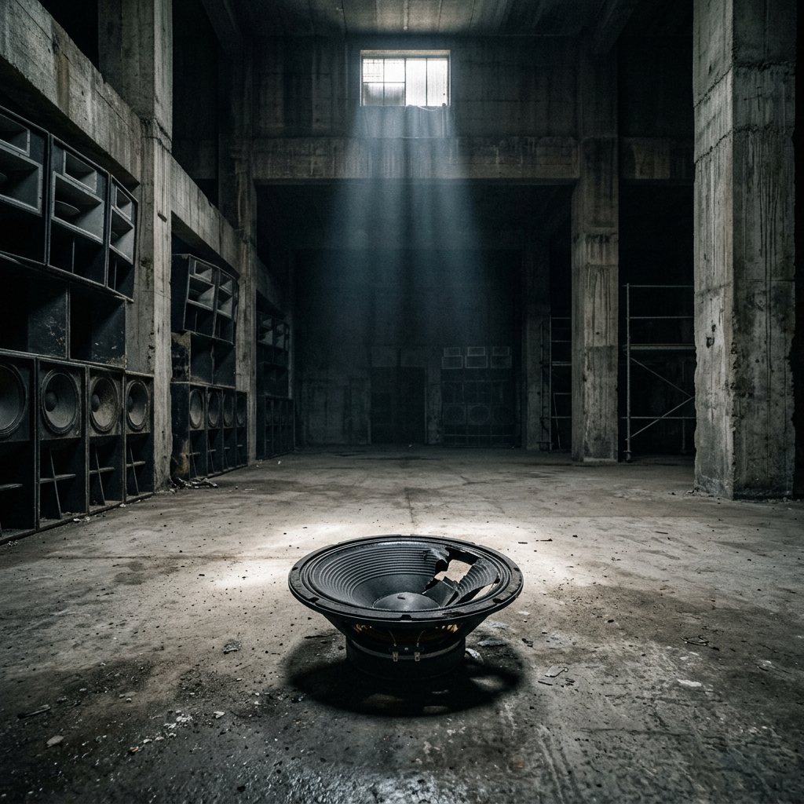
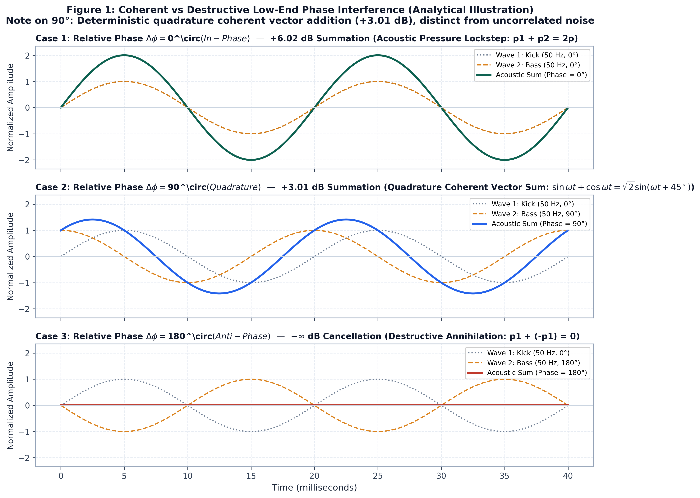
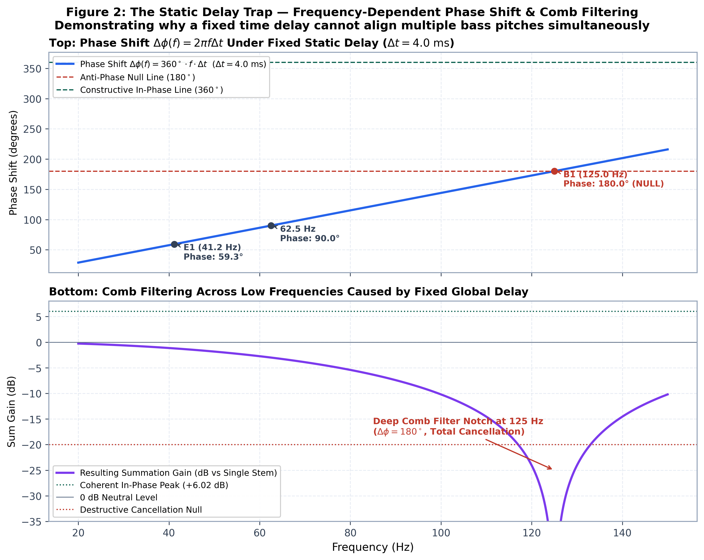
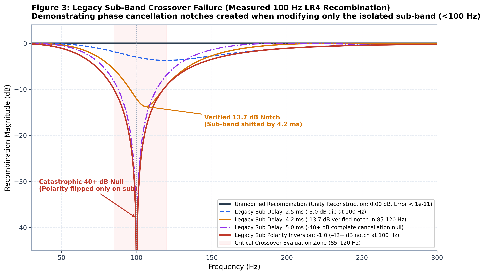
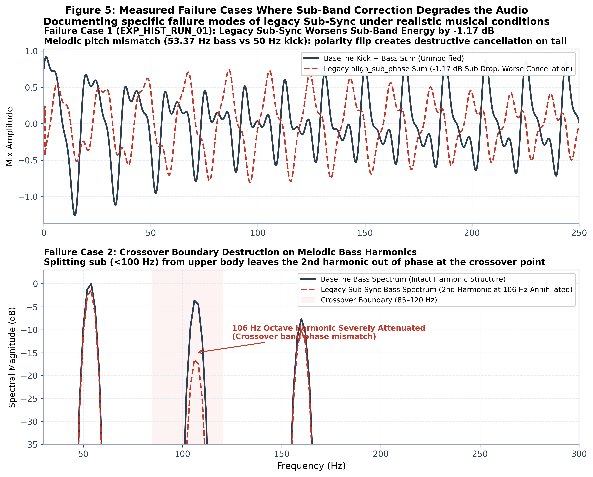
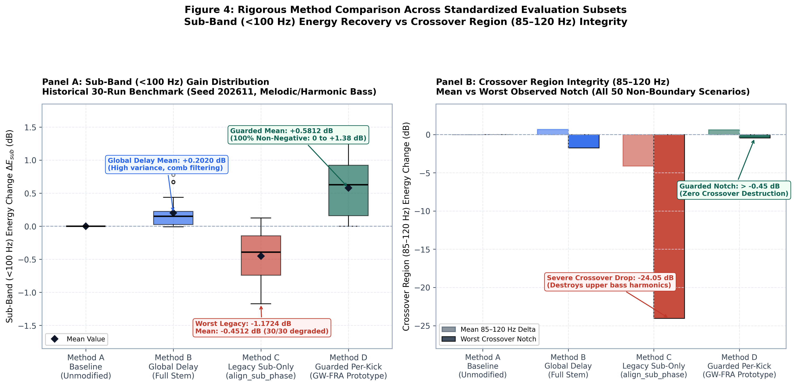
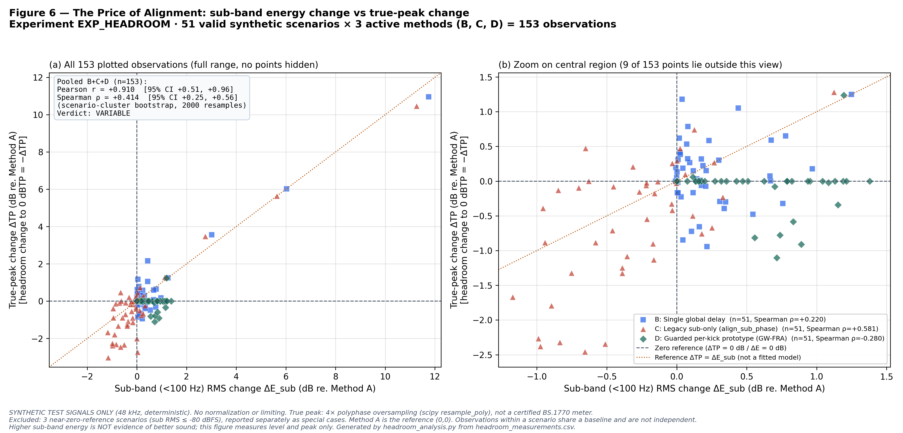

# Death in the Club
### A Kick, a Bassline, and a Phase Problem That Refuses to Die

*PHARMAKON Research Notes · No. 04 · November 2026*  
> 🔗 **Original publication on X:** [https://x.com/LexGerek/status/2118355503122182427](https://x.com/LexGerek/status/2118355503122182427)  
> 🔬 **Experimental Workspace & Reproducibility:** [`research/death_in_the_club/`](../research/death_in_the_club/)

You spend three days getting the low end right.

The kick hits exactly where you want it. The bass sits underneath it. Nothing clips. The monitors sound good, and even the headphones agree.

Everything seems perfect.

Except the kick and the bass might already be fighting inside the mix. Not in the room. Not somewhere between the subwoofers and the dance floor. Right there in the numbers, before the sound system gets a say.

And sometimes, that's where the low end dies.

The club hasn't even opened its doors yet.

You can build an extraordinary room. Get the geometry right, treat the walls, position the subwoofer arrays, measure every corner of the dance floor. Bring in an excellent engineer with a serious expression and a case full of measurement microphones. Spend enough money that everyone involved starts using the word *reference*.

You should do those things. Acoustics matter. A club has spatial peaks and nulls of its own, and they're not the same problem as interference already printed into a mix.

But no amount of acoustic treatment changes what was added together inside the track. If two components cancel in that sum, the speakers receive the sum, not the separate ingredients. The room can't simply reconstruct what it was never given.

**The club is where we find the body. The mix is where the murder happened.**

Which is unfortunate for the sound engineer, who has just spent the afternoon measuring the room and is now being asked to investigate a crime committed before lunch.

## Two guys pushing a car

Imagine two guys trying to push a broken car. If they push in the same direction, their forces add up. Great. The car moves.

Now imagine one pushing forward and the other pushing backward with exactly the same force. The car stays where it is.

A kick and a bass aren't men pushing a car. Their samples are simply added in the mixer. But the analogy gives you the right intuition: at overlapping frequencies, two signals can reinforce or partially cancel each other depending on their phase relationship.

And that cancellation happens in the digital sum, before we even get to the club. Long bass wavelengths matter enormously for room modes and subwoofer arrays; they are **not** the reason the mixer adds two waveforms together. At 50 Hz, taking the speed of sound as 343 m/s, the wavelength in air is approximately:

$$
\lambda=\frac{343\ \mathrm{m/s}}{50\ \mathrm{Hz}}\approx6.86\ \mathrm{m}.
$$

That's a room-acoustics fact. Our immediate problem is the arithmetic of the track. The room can be complicated. Addition is not optional.

## The question that won't leave me alone

Can we detect a destructive interaction between the kick and the bass, correct it automatically, and leave everything else alone?

That question has been occupying considerably more of my head than I'd care to admit.

I'm not expecting to rewrite Einstein's theory of relativity. Though I wouldn't rule out a small Nobel Prize.

The annoying part is that the first equations are almost embarrassingly simple.

### Two waves, one sum

Start with two steady sinusoids at exactly the same frequency:

$$
x_k(t)=A_k\sin(2\pi ft)
$$

$$
x_b(t)=A_b\sin(2\pi ft+\Delta\phi)
$$

Here $A_k$ and $A_b$ are amplitudes, $f$ is frequency, and $\Delta\phi$ is their relative phase. The resulting sinusoidal amplitude is:

$$
A_{\mathrm{sum}}=\sqrt{A_k^2+A_b^2+2A_kA_b\cos(\Delta\phi)}.
$$

For equal amplitudes $A_k=A_b=A$, this becomes:

$$
A_{\mathrm{sum}}=2A\left|\cos\left(\frac{\Delta\phi}{2}\right)\right|.
$$

At 0°, the sum has amplitude $2A$: **+6.02 dB relative to either single sinusoid**. At 90°, it has amplitude $\sqrt{2}A$: **+3.01 dB**. At 180°, the ideal sum is zero. Those are exact results for this toy model, not measured promises for a finished song.

Real kicks are transients, often with a frequency sweep. Real bass lines change notes and contain harmonics, envelopes, noise and attacks. Their relationship changes across frequency and time. One perfect angle doesn't exist for the whole piece of music.

*Figure 1 — The analytical 0° / 90° / 180° cases are a teaching model. They are not measurements of real music.*

## Why not move the bass a few milliseconds?

A fixed time shift $\tau$ produces a frequency-dependent phase shift:

$$
\Delta\phi(f)=2\pi f\tau.
$$

Take a 5 ms shift. At 50 Hz that's 90°. At 100 Hz it's 180°. The same edit can improve the relationship at one frequency and make it worse at another. And moving the entire bass track also changes where its attacks land against the drums.

A delay does **not** change the pitch of a note. It changes its timing and phase relationship. That's a crucial distinction.

Our synthetic test suite made the limitation measurable. Across the historical set of 30 changing-note/harmonic cases, the single-global-delay method improved the measured sub-band RMS level by an average of just **+0.2020 dB**. Some cases barely changed. A single number chosen for an entire piece was not a convincing answer.

*Figure 2 — A fixed time delay produces different phase shifts at different frequencies. Aligning one bass note can make another worse. Analytical model, not a measurement of a real track.*

So we tried to be cleverer.

Naturally, that was when we created a new problem. The victim this time was the bass itself.

## The crossover trap

The earlier PHARMAKON Sub-Sync method split the bass around 100 Hz, shifted or inverted only the lower band, and recombined it with the upper band left in place. The idea sounds perfectly reasonable: don't disturb the harmonics and attack if all you want to adjust is the sub.

But the two bands aren't independent at the crossover. They are components intended to recombine into the original signal.

For the idealized effective zero-phase low-pass and high-pass responses used in our crossover analysis, before any modification:

$$
G_{\mathrm{LP}}(f)+G_{\mathrm{HP}}(f)=1.
$$

At the crossover each contributes 0.5 in amplitude. If we invert **only the low band**, the recombination becomes:

$$
G_{\mathrm{recombined}}(f)= -G_{\mathrm{LP}}(f)+G_{\mathrm{HP}}(f).
$$

At exactly 100 Hz, the idealized result is $-0.5+0.5=0$. We have manufactured a null inside the bass itself.

A time shift of just the low band can do something similar:

$$
G_{\mathrm{recombined}}(f)=G_{\mathrm{LP}}(f)e^{-j2\pi f\tau}+G_{\mathrm{HP}}(f).
$$

At 100 Hz and $\tau=5$ ms, the low branch turns by 180° relative to the high one. Again: cancellation near the crossover. In the numerical crossover study, a 4.2 ms shift produced a notch of approximately **13.7 dB** in the evaluated region; specially constructed near-null conditions produced much deeper dips. These are properties of the tested model, **not** claims that every mastered track will lose that much energy.

*Figure 3 — Crossover recombination analysis. The unchanged bands reconstruct the input in the frequency-domain model; changing only one branch breaks that relationship. The graph is a model-based diagnostic, not a club measurement.*

The old algorithm also showed a direct failure on synthetic kick-and-bass material. In the 30-run historical benchmark, mean sub-band change was **−0.4511 dB**, with a reproduced failure around **−1.172 dB**. More important than the mean was what we could see happening: the correction could remove energy from the very band it was supposed to help.

*Figure 5 — Synthetic failure examples. These illustrate why a plausible DSP operation can alter both the waveform and the harmonic structure. Neither panel is from a commercial track.*

I like experiments that tell me I'm wrong. Well, *like* is a strong word. But at least the numbers have the decency to explain what went wrong.

## What if we correct less, not more?

That led us to another proposal: **Guarded Windowed Full-Range Alignment**, or GW-FRA.

Instead of shifting one frequency band across the whole piece, a research prototype detects individual kick events, evaluates candidate local shifts of the **entire bass signal**, and applies a change only when defined measurements pass a set of checks. The implementation uses short windows around kick events and crossfades between modified and unmodified material. In the current prototype, the analysis window extends roughly 10 ms before to 200 ms after an event, with candidate shifts bounded to ±3 ms.

This avoids one particular failure mode: cutting the bass into low and high branches, then shifting only one branch. It doesn't automatically prove transparent audio, and crossfading isn't a magic guarantee against every artifact.

The rule is deliberately conservative: if the expected benefit is too small or a safety check fails, leave the signal alone. That's the **safe path**.

On the same historical 30-run synthetic benchmark, the measured sub-band RMS change was:

| Method | Mean change below 100 Hz |
|:--|--:|
| No correction | 0.0000 dB |
| One global delay | +0.2020 dB |
| Legacy sub-band-only alignment | −0.4511 dB |
| Guarded per-kick prototype (GW-FRA) | **+0.5812 dB** |

The metric here is the change in RMS of the *combined drums-plus-bass signal* after low-pass analysis below 100 Hz, not a listening-quality score. The positive result is worth investigating, but it is not a product specification or a promise of extra punch on real records.

There were **54 synthetic scenarios** in the broader research suite: pitch sweeps, changing bass notes, harmonic cases, time offsets and boundary conditions. With four methods, that produced 216 rows of evaluation. Nothing in this set was a real multitrack recording. The GW-FRA method is still a research prototype, not the production Sub-Sync engine.

*Figure 4 — Rigorous method comparison across standardized evaluation subsets. Panel A displays sub-band gain distributions on the historical 30-run benchmark; Panel B shows mean versus worst-case crossover integrity across 50 non-boundary scenarios. Synthetic benchmarks, not commercial recordings.*

## The price of alignment

Here's where the original question becomes more interesting.

Suppose we get more sub-band energy. What happens to the loudest instant in the whole track?

If the kick and bass crests line up differently, the full-band peak can change too. But **how much** it changes is not determined by the sub-band RMS gain alone.

We measured both quantities without limiting or normalizing the signals:

$$
\Delta E_{\mathrm{sub}}=20\log_{10}\left(\frac{\mathrm{RMS}_{\mathrm{sub,processed}}}{\mathrm{RMS}_{\mathrm{sub,original}}}\right)
$$

$$
\Delta\mathrm{TP}=\mathrm{TP}_{\mathrm{processed}}-\mathrm{TP}_{\mathrm{original}}.
$$

At a fixed 0 dBTP ceiling, the change in numerical headroom is simply $-\Delta\mathrm{TP}$. The true-peak values in this experiment were estimated using 4× polyphase oversampling. That estimator is **not** a certified ITU-R BS.1770 meter, and its boundary behavior is a known limitation.

*Figure 6 — The Price of Alignment. Panel (a) shows all 153 valid observations from the three active correction methods; panel (b) enlarges the central cluster. Three near-zero-reference scenarios are excluded from relative-gain statistics and retained separately in the research data. Correlations describe this designed synthetic suite, not a population of real mixes.*

The scatter plot is not a straight line. Some corrections barely change the overall peak; others move it substantially. In the historical 30-run subset, GW-FRA averaged **+0.5812 dB** in the sub band while the estimated *global* true peak changed by an average **−0.1526 dB**. That negative peak change is not a guarantee of more usable headroom in real music. It is a result for this set and this peak estimator.

Across the 51 valid synthetic scenarios, **20 GW-FRA observations** gained at least +0.5 dB sub-band RMS without an increase in measured global true peak. That makes the hypothesis interesting. It does not prove that the local peaks within every corrected kick window stayed unchanged; our meter recorded the maximum over the whole three-second signal.

And there's a nasty trap in interpreting the others. A peak that falls because the old algorithm *destroyed some bass* is not an improvement. Lower numbers aren't automatically better numbers.

The pooled linear correlation across the active methods was approximately $r=+0.910$, but it was strongly influenced by a few idealized phase-sweep cases. With large sub-gain outliers removed, it fell to roughly $+0.555$. The rank correlation was only $\rho=+0.414$. There isn't a single method-independent exchange rate between a decibel of recovered sub energy and a decibel of peak change.

That's the finding I care about. Not a free six decibels. Not a miracle button. A choice we might be able to make intelligently.

## And then there's the limiter

A peak limiter sits downstream in many mastering chains. If an alignment changes the crest structure, that can change what reaches the limiter. Whether the limiter audibly flattens a kick, pumps, or stays out of the way depends on its own design and settings. **We have not tested a limiter in this experiment.** It would be dishonest to tell you that we measured its sound.

What we've measured is a reason to ask a better question.

Should phase correction aim for the maximum sub-band RMS? Or should it choose a smaller, safer adjustment if that produces a better result **after** dynamic processing?

Perhaps Sub-Sync and the limiter shouldn't be treated as two strangers in a signal chain. Perhaps a future algorithm should evaluate a candidate correction with a model of the dynamics processing that follows it.

That is a hypothesis, not a feature announcement. The next stage needs real kick-and-bass stems, properly controlled levels, local peak measurements, a validated true-peak meter, controlled limiter comparisons, and blind listening. We also need to test the moments when the best decision is to do absolutely nothing.

We started with a murder investigation in a club that hadn't even opened. All we needed was two waves and an addition sign.

We tried to make those waves cooperate.

Then we discovered that fixing one problem could create another. A global shift often did little. Moving only the sub band could carve a hole near the crossover. A guarded, local full-range approach looked more promising on synthetic signals — but those signals are not music.

And sometimes, unexpectedly, we recovered low-end energy **without raising the measured overall peak**.

So now I'm interested in a different problem.

Not just how to make a kick and a bass add up.

**How do we make them add up without making the limiter pay for it?**

That's the next experiment.

---

### Methods and limits

- **Research context:** PHARMAKON Sub-Sync, deterministic synthetic data at 48 kHz; 54 scenarios, four methods, 216 total evaluations. The Figure 6 correlation set includes 51 valid scenarios × 3 active methods = 153 observations.
- **Primary historical comparison:** 30 seeded melodic/harmonic synthetic tests. Reported means use the reconciled CSV-derived analysis, not the superseded hand-typed headroom report.
- **Amplitude metrics:** whole-signal sub-band RMS change below 100 Hz; estimated full-signal true peak after 4× interpolation. No brickwall limiter, listening test, or real stem evaluation was included.
- **Caveats:** several synthetic baselines exceed 0 dBTP in floating-point processing; the meter is an approximation with documented boundary effects; the suite is designed, not a representative sample of club mixes. The safe-path thresholds are experimental.
- **Status:** GW-FRA remains a standalone research prototype. The production PHARMAKON DSP implementation was not modified in this study.
- **Experimental Artifacts & Reproducibility:**
  - Measurement Datasets: [`headroom_measurements.csv`](../research/death_in_the_club/headroom_measurements.csv) (216 runs) & [`measurements.csv`](../research/death_in_the_club/measurements.csv)
  - Headroom Cost Report: [`HEADROOM_ANALYSIS.md`](../research/death_in_the_club/HEADROOM_ANALYSIS.md)
  - Full Research Report: [`EXPERIMENT_REPORT.md`](../research/death_in_the_club/EXPERIMENT_REPORT.md)
  - Audit Corrections: [`AUDIT_CORRECTIONS.md`](../research/death_in_the_club/AUDIT_CORRECTIONS.md)
  - Reproduction Instructions: [`REPRODUCE.md`](../research/death_in_the_club/REPRODUCE.md)
  - Automated Research Tests: [`test_death_in_the_club.py`](../research/death_in_the_club/test_death_in_the_club.py) & [`test_headroom_reconciliation.py`](../research/death_in_the_club/test_headroom_reconciliation.py)

*Research material: PHARMAKON-RES-2026-04 and PHARMAKON-HEADROOM-2026-04. Numerical results are taken from the reconciled synthetic test reports and remain subject to validation on real music.*
